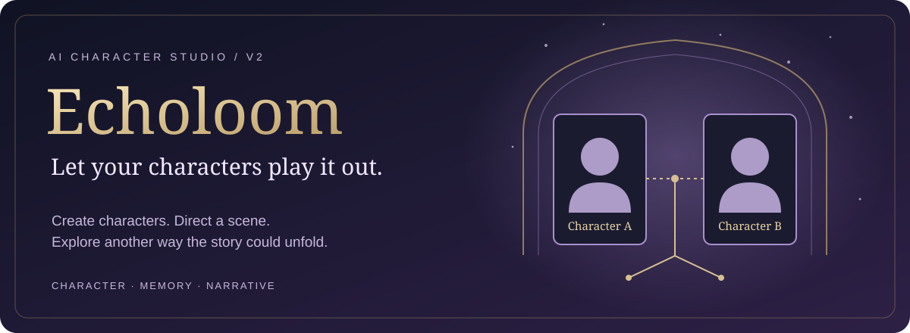
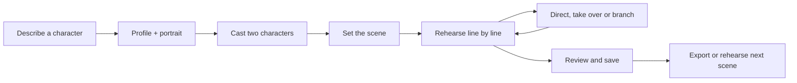
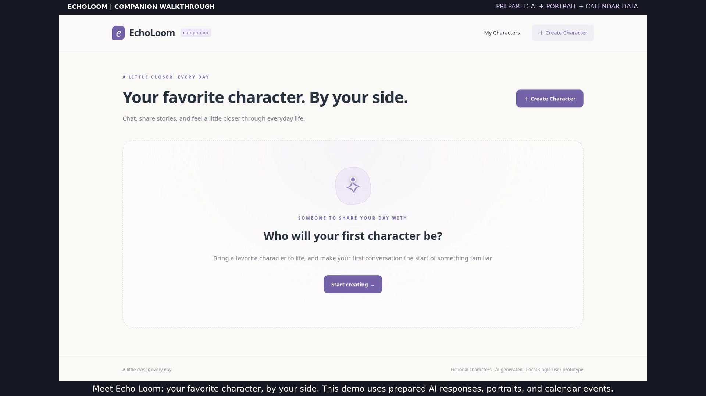
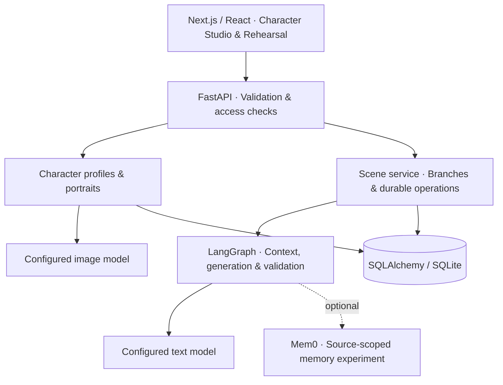

<div align="center">
  
  <h1>Echoloom V2</h1>
  <p><strong>Let your characters play it out.</strong></p>
  <p>An AI-powered character studio and interactive storytelling system for fiction creators.</p>
  <p><a href="#try-it-locally"><strong>Try the prototype</strong></a> · <a href="#architecture"><strong>Explore the architecture</strong></a> · <a href="#research-foundations"><strong>Read the research</strong></a></p>
  <p>
    
    
    
    
    
  </p>
</div>

> **Status:** Working local research and product prototype. The header is an original conceptual illustration, not an application screenshot. Live model quality, cost and physical-phone behavior require further validation.

## The idea

What if fictional characters could continue beyond the stories in which we first met them? What if we could create new situations, explore alternative reactions, and guide the narrative without losing what makes each character distinct?

Echoloom began as an AI character companion and evolved into a **scene rehearsal studio**. The focus is on persistent characters, author-controlled narrative, and coherent character behavior rather than a single conversation with a chatbot.

## From character to story



| Experience | What the prototype supports |
| --- | --- |
| **Character Studio** | Generate a structured character profile and portrait; edit, refine, and restore prior versions. |
| **Scene Rehearsal** | Choose two characters, define a premise and optional constraints, and read their performance one line at a time. |
| **Creative Direction** | Introduce an event, intervene, take over one role, or explore alternative responses. |
| **Story Versions** | Preserve original branches, compare alternatives, save an approved version, and export the scene. |
| **Narrative Continuity** | Start a subsequent scene from a saved result with source-linked character snapshots and state. |
| **Companion Archive** | Revisit earlier character chats, shared stories and optional Google Calendar integration. |

## Watch the original companion prototype

<a href="demo/README.md"></a>

[**Watch the companion walkthrough (MP4)**](demo/EchoLoom-prototype-demo.mp4) · [Demo scope and recording notes](demo/README.md)

This is a recording of the earlier companion workflow, showing actual application interactions with prepared AI responses, portraits and calendar fixtures. It is not a recording of the latest rehearsal interface or a live-model benchmark.

To explore the **current scene rehearsal interface**, run the application and select **The station reunion · Demo**. It uses prepared performances and does not require model credentials; saved versions and exports persist.

## Architecture



| Layer | Technologies |
| --- | --- |
| Frontend | Next.js 16, React 19, TypeScript |
| Backend | Python 3.12+, FastAPI, Pydantic |
| AI orchestration | LangGraph 1.2.20, structured generation, validation and checkpoints |
| Persistence | SQLAlchemy, SQLite, Alembic |
| Experimental memory | Mem0, local Qdrant and source-linked retrieval |
| Testing | Pytest, Playwright, Ruff |

### Engineering and research challenges

- **Character consistency:** maintain structured world facts, beliefs, goals, relationships and knowledge boundaries across narrative branches.
- **Author control:** preserve user-authored lines, versions and accepted story results rather than silently rewriting them.
- **Reliability:** persist operation IDs and revisions; support pause, explicit retries and recovery without inserting duplicate lines.
- **Memory:** compare baseline context against an optional source-scoped Mem0 retrieval pipeline. It is disabled by default; improvements in long-term consistency have not yet been established.

The generation pipeline validates a structured segment before committing complete blocks; it does not provide token-level real-time streaming. Structural checks do not guarantee semantic consistency.

## Try it locally

Python 3.12+, Node.js 20.9+ and npm are required. See the [full installation guide](docs/mvp/README.md) for provider configuration, Windows PowerShell commands and updates.

**macOS / Linux, first installation:**

```bash
git clone https://github.com/Roxyh-code/Echoloom_V2.git
cd Echoloom_V2
python3 -m venv .venv
.venv/bin/python -m pip install -r requirements-dev.lock
.venv/bin/python -m pip install --no-deps -e .
cp .env.example .env  # first installation only
.venv/bin/alembic upgrade head
.venv/bin/uvicorn echoloom.api:app --host 127.0.0.1 --port 8000 --reload
```

In a second terminal:

```bash
cd web
npm ci
npm run dev
```

Open **[http://127.0.0.1:3000/rehearsal](http://127.0.0.1:3000/rehearsal)**. Real character and scene generation requires configured server-side model credentials. Never commit keys or local story data.

- [Rehearsal walkthrough and Windows update guide](docs/product/scene-rehearsal.md)
- [Rehearsal PRD](docs/product/scene-rehearsal-prd.md) · [Product positioning](docs/product/README.md)
- [Optional Mem0 experiment and A/B evaluation](docs/mvp/rehearsal-memory.md)

The previous Creator remains at `/creator` and the companion archive at `/companion`. The unified character studio is available at `/characters`. Existing data is preserved; see the migration and backup guidance below.

## Project structure

```text
src/echoloom/   Backend API, validated profiles, database models, provider adapters
web/           Next.js mobile rehearsal studio, previous Creator, and companion
alembic/       Database migrations
tests/mvp/     Backend regression tests
docs/mvp/      MVP requirements and development guide
work/          Ignored local database, portraits, and scratch files
literature/    Original research, source records, reading notes, and reports
schemas/       Research-driven schema design
data/          Future original character fixtures and annotations
experiments/   Method comparisons and research evaluations
```

## Existing records survive updates

Keep `.env`, `work/echoloom.db`, `work/portraits/`, `work/secrets/calendar.key`, and the same database/storage settings. Pulling code, restarting the application, or refreshing the browser does not delete saved characters, messages, versions, or portraits. Back up data with the application stopped. Run `alembic upgrade head` after upgrading dependencies. Migration 0002 adds story tables and timeline ordering; migration 0003 adds accounts and calendar support. Migration 0004 adds Creator works and recovery requests, and a character archive flag. Migration 0005 adds rehearsal scenes and durable operations. These migrations preserve existing records. The first local account claims existing characters, history, Creator works and rehearsals.

## Research foundations

The original research track remains available: reconstruct fictional characters from incomplete, multiple-source text and link judgments to source evidence. Role-play performance is not equivalent to reconstruction accuracy. This project is not a psychological assessment tool for real people; multi-document extraction is not implemented in the MVP.

- [Literature entry point](literature/README.md)
- [Schema foundations report](literature/output/schema-foundations/report.md)
- [Field-to-evidence matrix](literature/organization/schema-field-matrix.md)
- [Research next steps](literature/plans/next-steps.md)
- [Original research roadmap](docs/roadmap.md)

Research documents and the originally supplied PRD are retained in their source languages. Downloaded papers and extracted full text stay local and are not committed.


## Related project

**[Echoloom Marketplace](https://github.com/Roxyh-code/Echoloom_marketplace)** extends this foundation with character discovery, publishing, public listings and two-character casting for a hackathon prototype. This repository is the original character and narrative research system; Marketplace is a separate product extension.
