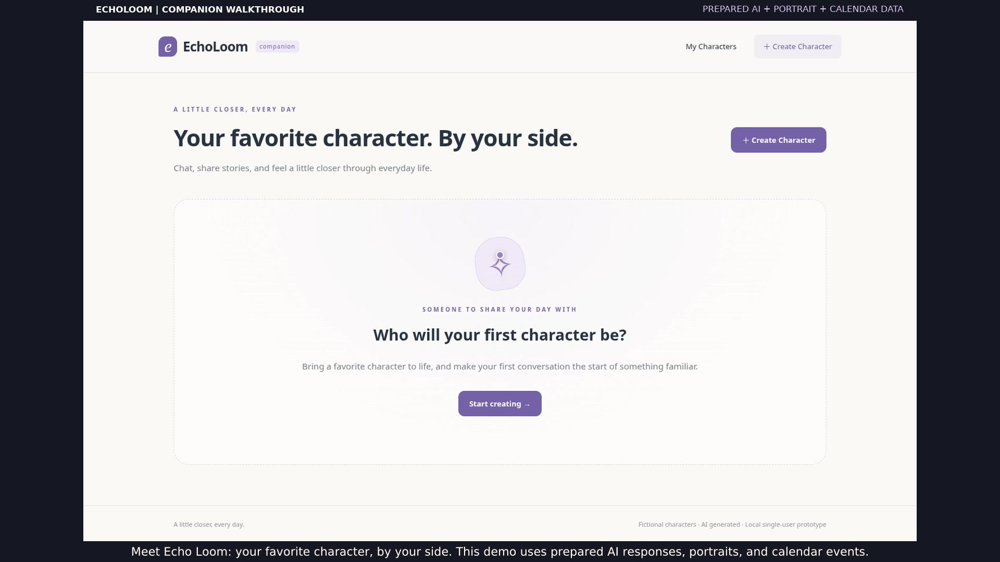

# EchoLoom companion walkthrough — v3

**Your favorite character. By your side.**

[Download the latest MP4](https://github.com/Roxyh-code/Echoloom_V2/raw/refs/heads/main/demo/EchoLoom-prototype-demo.mp4)

A **4-minute-8-second**, 1080p walkthrough with a brighter synthetic English narrator and English subtitles. Updated November 4, 2026.

The video follows Evelyn from character and portrait creation into ordinary chat, an extended shared story, two decisions, a change of direction, a playful rewrite, and calendar-aware conversation. After calendar connection, the character gives a two-sentence acknowledgment and asks about an upcoming physics exam; the user replies across three further turns.

## Chapters

| Time | What happens |
| --- | --- |
| 00:00 | Companion positioning and sample-data disclosure |
| 00:08 | Create and shape Evelyn |
| 00:23 | Generate, edit and restore a portrait |
| 00:48 | An ordinary conversation |
| 01:10 | Invite a shared story |
| 01:37 | Speak in your own words |
| 01:50 | Make two story choices |
| 02:07 | Change the direction |
| 02:27 | Rewrite the tone and continue talking |
| 03:00 | Connect a sample calendar |
| 03:13 | Immediate greeting about next week’s exam |
| 03:21 | Three follow-up conversation turns |
| 04:00 | Return to your companion |

## What is real and what is prepared

The actual prototype UI, saved records, story choices, rewriting and calendar workflow are recorded against an isolated temporary database. **AI responses, generated/edited portraits, calendar events and the consent screen use prepared demo data.** This is disclosed in the opening narration, on the simulated consent page, and throughout the video.

No real Google account is accessed, no paid model calls are made, and no real user records or credentials appear. This is an interaction walkthrough, not evidence of live model performance or completed real-account Google verification.

The narrator explains the process; character dialogue is displayed as text. The narration uses the offline Kokoro English v0.19 model, speaker 0, through sherpa-onnx, at a lively conversational pace. This does not imply a shipped in-app voice feature. Model source: [official sherpa-onnx TTS releases](https://github.com/k2-fsa/sherpa-onnx/releases/tag/tts-models); Kokoro model license: Apache-2.0.

## Files

- `EchoLoom-prototype-demo.mp4`: H.264, 1920×1080, AAC stereo English narration, burned-in English subtitles.
- `EchoLoom-prototype-demo.en.srt`: separate English captions.
- `narration.txt`: process narration script.
- `preview.jpg`: preview frame from this recording.

The video fully decodes without errors. Runtime is 247.53 seconds; audio is present, unclipped, and tagged English. Recording checks reported no browser errors. The recording uses the existing app without product-code changes.

Product direction is documented in [positioning](../docs/product/positioning.md) and the [product roadmap](../docs/product/roadmap.md).
