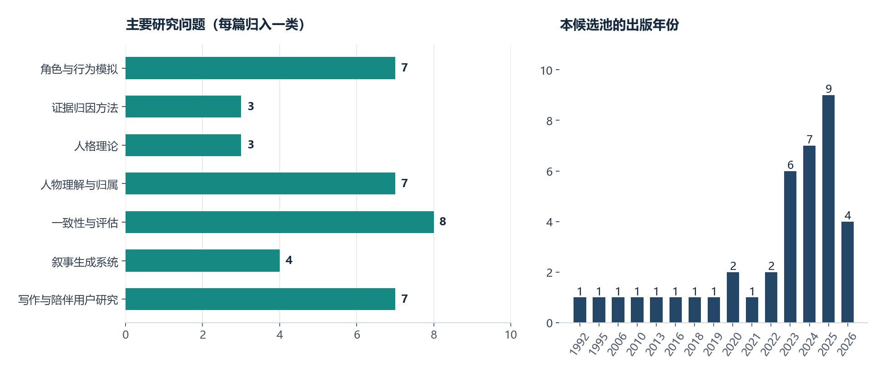
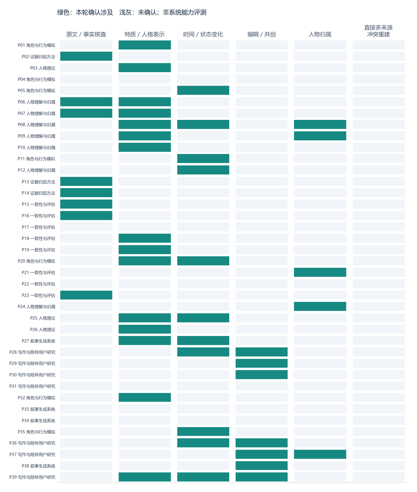
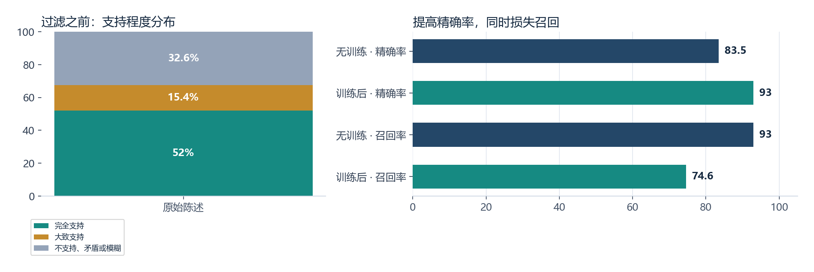
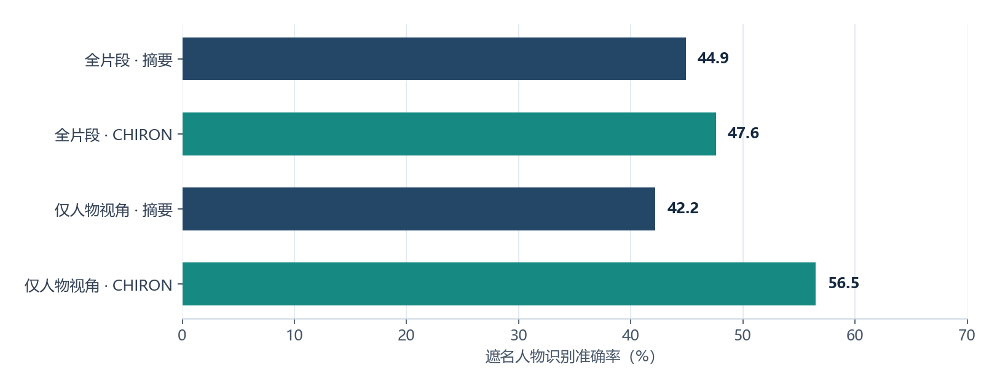
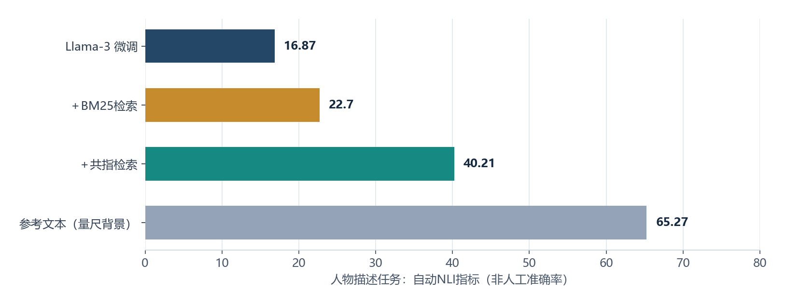
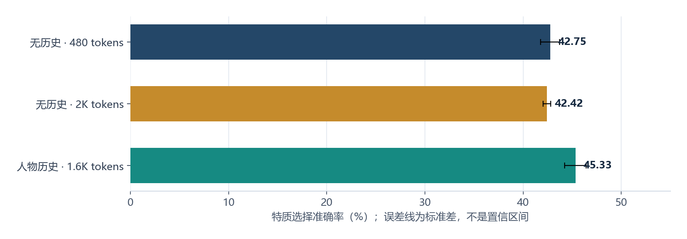
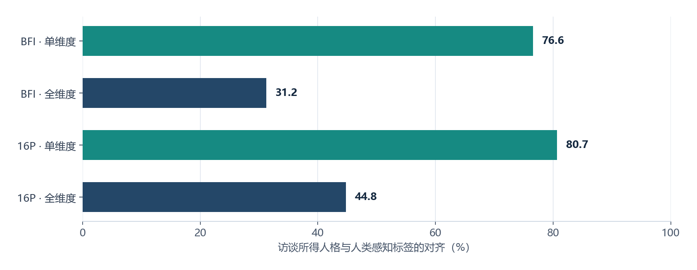
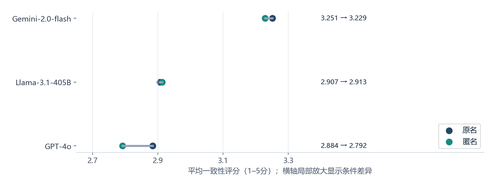
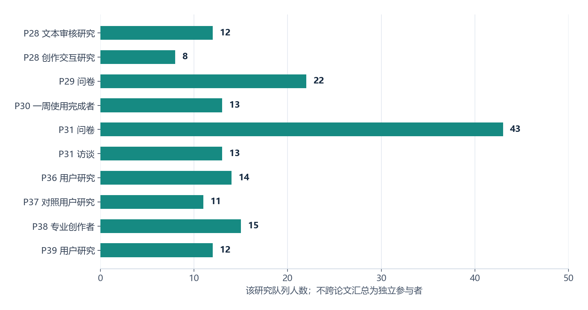

# EchoLoom：从多来源材料重建人物，现有研究支持什么？

文献结论报告 v1 · 截至 2026-10-31 · 39篇目的性候选 · 图表由编码数据生成

## 先看结论

**当前最有依据的路线，是先恢复可核查的事实与情境，再提出可审核的人格解释，最后用角色行为测试验证它是否有用。** 直接把全部材料压成一段人格描述，可以保留作基线，但目前没有理由把它当作最终方案。

这个结论有三层依据：人物表示研究说明结构和检索值得比较；归因研究说明引用与正确不是同一件事；角色评估研究说明“表现像人物”仍不能代替“忠实于输入”。这些研究任务不同，报告不把它们合成一个总准确率。

本轮完成39篇的逐篇第一轮筛读和编码，其中37篇取得全文并定向核对相关段落，2篇仅作摘要层面的理论背景。**尚未完成39篇逐页精读、代码复现或第二编码者复核。** 文中的数字是作者报告的数据，我们重新核对和绘图，不是EchoLoom自己的实验结果。

## 一、文献是怎样进入报告的

起点是先前讨论的5篇：RoleLLM、FActScore、Five-Factor Model、PersonaChat与Generative Agents。随后沿Nicole Zhao本人、共同作者和实际参考文献扩展，并补充人物理解、证据归因和评估论文，形成固定的39篇候选池。已有地图中记录20条核实的引用边；这不是完整引用网络。

本轮没有进行数据库全量导出、预注册系统检索或双人筛选，因此不能画出一个虚构的“检索数千篇、最终纳入39篇”的PRISMA流程。真实流程只有：5篇起点 → 39篇目的性候选 → 37篇可读全文＋2篇摘要背景 → 39条编码记录。

P25全文下载受访问限制，P26可找到PDF但本地未取得可读文本；两者不进入任何实证效果统计。其余PDF合计951页，包含参考文献与很长的剧本附录，不能把这个页数解释为已精读951页。

**图1说明。** 每篇只放入一个主要方向；年份用正式出版年或预印本首发年。这是我们选取的文献构成，不代表整个领域的年度产量。细分任务与逐篇记录在报告末尾。

## 二、现有研究到底在解决哪些不同问题

| 问题 | 典型输入 → 输出 | 代表论文 | 能支持什么 | 不能直接说明什么 |
| --- | --- | --- | --- | --- |
| 人物理解 | 故事片段／整书 → 特质、描述或分析 | CHIRON、PersoNet、BookWorm | 人物表示与抽取方法 | 从用户混合来源恢复唯一正确人格 |
| 证据归因 | 主张＋文本 → 支持判断 | FActScore、ALCE、ALiiCE | 原子主张与引用校验 | 复杂人格解释在心理学上成立 |
| 角色模拟 | 已给档案／场景 → 对话或行为 | RoleLLM、CoSER、Character-LLM | 档案如何供生成端使用 | 档案是从材料正确推断出来的 |
| 一致性评估 | 回答／对话 → 矛盾、人格对齐或身份识别 | InCharacter、PersonaEval、PICon | 可以怎样检查表现 | 一个评分器足以证明人物忠实性 |
| 共创与审核 | 文本与结构 → 用户编辑和探索 | Nicole相关HCI研究 | 交互、可控性和用户任务 | 用户喜欢就意味着抽取事实正确 |

这些工作常被都叫作“persona研究”，但它们的输入、目标和真值完全不同。我们应先选择能回答当前问题的证据，再决定是否采用其架构。

**图2说明。** 实心格表示本轮读到明确研究线索；空白表示尚未确认，不表示系统不支持。最后一列为严格定义的“多来源冲突下的人物重建”直接任务，本轮未核到；这是候选池内的覆盖缺口，不能写成全球研究空白。

## 三、人物理解：结构、检索和情境有用，但代价必须一起看

### 1. 人物档案不能只要求“写得合理”

CHIRON从529个故事构建人物档案，并标注1,000条生成陈述。其标注中52%完全支持，15.4%大致支持，32.6%落入不支持、矛盾或模糊等类别。**32.6%不是“全部是编造”的比率。** [P06](https://aclanthology.org/2024.findings-emnlp.499.pdf#page=5)

在同文的验证器比较中，从zero-shot无中间推理到训练后的完整设置，precision由83.5%升至93.0%，recall由93.0%降至74.6%，accuracy也由82%变为78%。这支持“过滤可能提高保留内容的可靠性”，同时说明有效信息可能被丢掉；它不支持笼统的“训练后所有指标更好”。[P06 Table 3](https://aclanthology.org/2024.findings-emnlp.499.pdf#page=5)

对我们而言，最低限度是保留支持、反证、模糊与无法判断，而不是用一个不透明置信分数把所有情况混在一起。单纯优化支持率可能诱导系统少说甚至不说，因此必须另测覆盖和拒答。

### 2. 结构化表示有下游收益，收益的范围也有限

CHIRON的遮名人物识别实验有147个人物实例。在不限制人物视角的条件下，摘要基线44.9%，完整档案47.6%；只取人物自身视角时，摘要42.2%，完整档案56.5%。同文最优类别组合达到58.5%，但这个结果涉及选择类别子集，不宜拿它作唯一代表。上述比较的目标是识别人，不是人格抽取准确率。[P06 Table 6](https://aclanthology.org/2024.findings-emnlp.499.pdf#page=7)

综合判断：值得用结构化档案与自由摘要做对照；不应把具体论文的字段直接宣布为适用于所有来源的标准。我们还需要检查字段是否能表达不确定、版本冲突和用户修正。

### 3. 检索相关人物信息，往往比粗暴压缩全书更值得先试

BookWorm区分事实性人物描述和解释性人物分析。描述任务包含324本书、5,869个样本；分析任务为133本书、1,328个样本，不能相加后称为457本独立书。[P07 Table 1](https://aclanthology.org/2024.findings-emnlp.258.pdf#page=4)

其微调Llama-3在描述任务的自动NLI指标中，从16.87提升到BM25的22.70、共指检索的40.21。这个NLI分数不是人工事实准确率；参考文本本身在该指标上也只有65.27。论文还发现，微调对描述更稳定有益，对解释性分析不总是有益，事件和关系更难处理。[P07 Tables 2–3](https://aclanthology.org/2024.findings-emnlp.258.pdf#page=8)

因此，我们可以先比较人物检索和证据验证，暂不把微调当作第一步。与此同时，归属错误会让正确文本变成错误人物的证据；BOOKCOREF的gold部分只有3本书，提醒我们大规模silver数据与小规模人工真值是不同层次的证据。[P24](https://aclanthology.org/2025.acl-long.1197.pdf#page=6)

### 4. 更长的上下文不等于更好的情境理解

PersoNet英文测试中，Longformer无历史480 tokens为42.75±0.97，扩到2K为42.42±0.39；加入人物历史的1.6K方案为45.33±1.11。误差为论文报告的跨运行标准差，不是置信区间。不同方案同时改变信息内容和长度，不能将差值全部归因于某一个机制。[P08 Table 4](https://arxiv.org/pdf/2305.10156#page=8)

综合判断：我们需要知道“相关历史是什么、行为发生在什么情境”，而不是只把上传文件塞进更大的窗口。人格与临时情绪也不能混为一谈。CAPS与New Big Five提供理论方向，但本轮仅核其摘要，所以它们只作为概念参照，不作为算法效果证据。[P25](https://pubmed.ncbi.nlm.nih.gov/7740090/)、[P26](https://pubmed.ncbi.nlm.nih.gov/16594837/)

## 四、证据链：有引用，不代表它支持结论

FActScore用183位人物的传记生成研究原子事实支持率。论文中的42.5、58.3和71.5是当时系统在该任务的结果，不是今天模型的一般事实准确率，更不是EchoLoom可继承的指标。[P02 Table 1](https://aclanthology.org/2023.emnlp-main.741.pdf#page=4)

ALCE进一步区分回答是否正确、是否充分，以及引用是否真正支持回答；ALiiCE将核查推进到句内原子主张。我们应该采用这个问题分解，而不是照搬问答分数作为人格评分。[P13](https://arxiv.org/pdf/2305.14627#page=4)、[P14](https://aclanthology.org/2025.naacl-long.23.pdf#page=3)

FABLES的3,158条长书摘要主张中，作者对205条可分析的不忠实错误做了进一步分类：38.6%涉及人物／关系状态，31.5%涉及事件，50.2%需要间接推理才能反驳。这里的分母是错误分析子集，且允许多标签，不能解释为全体主张错误率。它特别提醒我们审核动态关系与事件。[P15 Table 3](https://arxiv.org/pdf/2404.01261#page=5)

**设计建议。** 把“原文观察”和“人格解释”分开。例如，一个角色拒绝一次聚会，可以是疲劳、恐惧、讨厌某个人，也可能是稳定的社交倾向。支持行为发生的证据，不自动支持其中任一种人格解释。界面应该让用户看到原文、解释和替代解释之间的关系。

## 五、人格评估：不能只看单维度高分和模型自评

### 1. 单维度对齐与整个人格对齐差别很大

InCharacter在32个知名人物上研究访谈式人格评估。GPT-4 ER-batch设置中，BFI单维度对齐76.6%，全维度对齐31.2%；16P分别为80.7%和44.8%。边缘维度按论文规则忽略，分母不能简单还原成固定的32×维度数。标签代表熟悉人物的人和平台贡献者的感知，不是人物存在唯一心理学真值。[P19 Table 2](https://aclanthology.org/2024.acl-long.102.pdf#page=7)

这不否定访谈的价值，但说明“人格准确率80.7%”如果省略任务、量表与计分方式，会误导产品决策。我们要分别记录特质表现、故事事实、关系态度和知识边界。

### 2. 自动评估器也需要被评估

PersonaEval中，最强模型在全量角色识别上的68.8%，与20名人类在每人50个困难案例上的90.8%，并非同样本随机对照。我们保留两者的研究含义，但**不计算一个严格的22个百分点“人机差距”**。而且身份识别是评估器能力的一部分，不能扩张成所有LLM评估都无效。[P21 Figure 3 / §4.4](https://arxiv.org/pdf/2508.10014#page=8)

CoSER提供另一种证据：其训练与场景数据在多个任务上有收益，但人工与模型裁判的偏好排序不完全一致。对于人工评价，60个场景、7种模型和3名标注者的设计，与自动评价的分数不是同一种测量。[P20 Tables 2–5](https://arxiv.org/pdf/2502.09082v3#page=11)

**综合判断。** 可以用模型筛查和辅助评分，但最终实验应有独立人工抽样、盲评、错误分析及难例。不能由同一模型生成档案，再给它的档案和回应打高分，就宣布重建成功。

### 3. 匿名评估值得做，但效果不是一刀切

在CharacterEval的平均角色一致性评分（1–5分）中，GPT-4o从原名2.884变为匿名2.792；Gemini-2.0-flash为3.251→3.229；Llama-3.1-405B为2.907→2.913。仅前者的平均下降在该表中有显著标记。论文总体强调匿名化挑战，具体结果仍存在模型和维度差异。[P22 Table 2](https://arxiv.org/pdf/2603.03915v2#page=4)

所以我们采用原创角色、匿名化以及持出材料，不是因为“匿名一定降低所有系统”，而是为了更清楚地区分模型认识角色名字和系统理解用户材料的能力。

PICon则提示多轮追问能暴露内容矛盾，但其研究范围明确排除虚构人物、说话风格和人格特质。我们只能借鉴追问思路，并把外部现实事实改成故事世界内事实，不能把它原封不动当作人格一致性基准。[P23 §2](https://arxiv.org/pdf/2603.25620#page=2)

## 六、Nicole及合作者的工作，对我们最直接的启发是什么

### 1. 人物模拟论文给了架构问题，没有替我们验证上游抽取

P27从230个写作提示中选取28个，用参考故事反推计划，再比较角色模拟与重写等方案。它的主要自动评价是Gemini-1.5-Pro成对偏好，并交换故事呈现顺序；不是28个用户，也不是人格抽取正确率。[P27 §4–5](https://aclanthology.org/2025.in2writing-1.9.pdf#page=5)

我们应重点追问：给定人物信息时表现更好，是否意味着这些信息可以从混合材料中可靠恢复？答案目前不能由该实验直接给出。作者也讨论场景内倒叙和角色信息隔离的限制，这恰好对应我们需要明确的数据边界。

### 2. 交互证据主要来自小样本、特定任务

Visual Story-Writing分别有12人与8人的研究；第二研究的CSI为71.5±21.12。Nabokov’s Cards最终13名专业写作者完成一周使用；Dramatron评价涉及15名行业人士。它们支持“结构、控制和人工接管值得设计”，不能直接说明哪种界面能提高人物抽取准确率。[P28](https://zixin.ca/data/pdf/visualstorywriting.pdf#page=9)、[P30](https://zixin.ca/data/pdf/Nabakov_s_Cards_C_C_2025.pdf#page=4)、[P38](https://arxiv.org/pdf/2209.14958)

Making the Write Connections的初始67篇文献、补搜11篇、115个工具和22份问卷，是需求研究的多种材料，不是215个独立实验。Large Language Lovers的43份问卷和13次访谈则强调平台变化及用户维护关系的方式，不能转换成“稳定人格能改善心理健康”的因果结论。[P29](https://arxiv.org/pdf/2502.13320#page=3)、[P31](https://arxiv.org/pdf/2601.13188#page=6)

图中的队列不跨论文加总；同一参与者是否在不同研究中出现，本轮没有核实。HCI结果应帮助我们确定审核任务，而不是为技术准确性背书。

### 3. 新近工作也不能只挑最漂亮的百分比

Narrative Keyframing在人工30对比较里，多数票人物刻画偏好29/30，整体质量25/30；所有个体判断的百分比又不同。它属于生成与交互研究，且作者指出更丰富细节可能使文本冗长。我们借鉴“变化可追踪”的目标，而不是把96.7%写成人格重建成功率。[P39 §6](https://arxiv.org/pdf/2608.10337#page=7)

## 七、哪些结论较有依据，哪些仍只是设计假设

| 判断 | 证据状态 | 我们应怎样行动 |
| --- | --- | --- |
| 人物事实与解释应分开检验 | 多类任务提供相互补充的依据 | 在数据模型与评价中分层 |
| 引用存在不等于结论被支持 | 归因与事实核查研究直接支持 | 原子主张绑定来源，独立检查支持关系 |
| 检索与验证值得优先比较 | 人物理解任务有条件性结果 | 与全量拼接作同材料对照，不预设一定胜出 |
| 稳定人格不等于永远相同行为 | 情境特质研究、动态关系研究与理论共同启发 | 保留情境、时间、状态与替代解释 |
| 更长上下文或微调自动解决问题 | 本轮不支持这种笼统说法 | 单独比较输入信息、模型能力与成本 |
| 人工审核界面会提高EchoLoom正确率 | 尚未直接验证 | 作为待测假设；测找错率、修正时间和误改 |
| 混合来源冲突重建是无人研究的空白 | 本轮证据不足 | 定向补搜后才能讨论创新性 |
| 一份档案能支持长期稳定的开放互动 | 尚未在我们的系统验证 | 先做多轮与增量更新测试，再谈长期部署 |

## 八、EchoLoom下一步做什么

### 1. 先把研究贡献缩成一个可测试的问题

建议问题：**相同来源材料与可比预算下，保留主张—证据—情境结构，能否比自由摘要得到更忠实、覆盖更充分、纠正更容易的人物模型？** 这是一项设计与评估假设，不能在实验之前宣称已有效。

### 2. Schema v0.1先保留六类信息

| 层次 | 最小内容 | 作用 |
| --- | --- | --- |
| 来源 | 文档ID、类型、作品版本、定位、用户优先级 | 区分原著、互动和分析，而不是简单拼接 |
| 观察 | 原文片段、人物／说话者、故事时间与视角 | 先确认发生了什么、是谁的行为 |
| 主张 | 单一可检验的陈述、支持／反证／未知 | 不把一整段档案当作一个事实 |
| 解释 | 特质、目标、价值观、语言习惯、情境行为 | 与直接观察分开，允许替代解释 |
| 冲突 | 两端主张、版本或时间差、处理状态 | 不静默删除冲突材料 |
| 审核 | 确认、修改、拒绝、理由和版本 | 可以纠正，也可以回溯 |

字段数量和名字还需要人工样例检验。Big Five可作可选映射，暂不强制生成数值。没有来源的合成人物经历必须标成生成内容，不能回写原著事实。

### 3. 实验分三步，防止一个总分掩盖问题

**第一步：人工建模试验。** 先准备3个原创角色、各3份材料、约60条主张，检查结构能否表示版本冲突、临时状态、反讽、他人评价、倒叙和信息不足。这一步验证任务是否定义得清楚，不作泛化声明。

**第二步：受控方法比较。** A为全材料自由摘要，B为人物检索＋结构化提取，C为B再加独立证据验证。尽量控制基础模型、材料、输出长度和调用预算；无法等预算时报告成本，并增加等预算对照。开发与持出角色分离，不能用持出集选字段和提示词。

**第三步：审核与行为检查。** 人工盲核原文支持、覆盖、归属与冲突；另外做匿名新情境和多轮追问。最后测用户发现错误、修正错误的时间及新增误改。行为测试不替代事实检查，两组结果并列报告。

建议预先定义“支持率、重要主张覆盖、人物归属、冲突识别、无依据人格推断、审核成本”六项主指标。拒答、无法判定与部分支持单列，不能算作支持，也不能统统算作编造。完成试标注后再确定阈值与更大样本规模。

### 4. 和Nicole讨论的材料现在可以具体化

带上一个“同样行为、不同情境导致不同人格解释”的原创案例，一张来源—观察—解释图，以及上面的A/B/C实验。请她重点评论：人物知识边界、故事时间与视角、可审核的结构、用户任务，以及自动评分的局限。问题应围绕她工作的证据范围，不假设她已研究过所有人格抽取问题。

## 方法和局限

本报告是面向项目设计的快速证据综合，非系统综述或元分析。目的性选文偏向英文NLP／HCI、已知作者与公开全文；未穷尽中文工作、文学理论、跨来源真值发现和版本管理。39篇论文不等于39个独立数据集；共享基准和共同作者会造成依赖。

37篇为全文定向核读，未逐页精读所有内容；P25／P26仅摘要。文本提取可能错排双栏表格，因此图表使用的关键数字按表格上下文定向复核，仍未经过第二位人工编码者逐格审查。没有进行作者代码复现，也没有把新近预印本视为已被独立验证。

图表只采用有定位的数字，所有总体计数都能追到编码记录。特征矩阵的空白是未确认，不是缺失能力；趋势图只描述我们选取的候选池；不同任务的分数不合并；缺少区间时不补造。设计建议为待验证假设，尤其是多来源冲突处理和用户审核收益。

## 附录：可追溯数据和逐篇记录

交互版附有可搜索的39篇明细：方法、研究规模、结果位置、局限、设计启发、版本及PDF指纹。图表数字另列一张表，保留论文原值、指标单位和适用范围。

更新规则：修订编码数据后重新运行构建脚本；不要手动改图里的数字。若后续逐页精读发现差异，保留修订说明，再更新结论。
