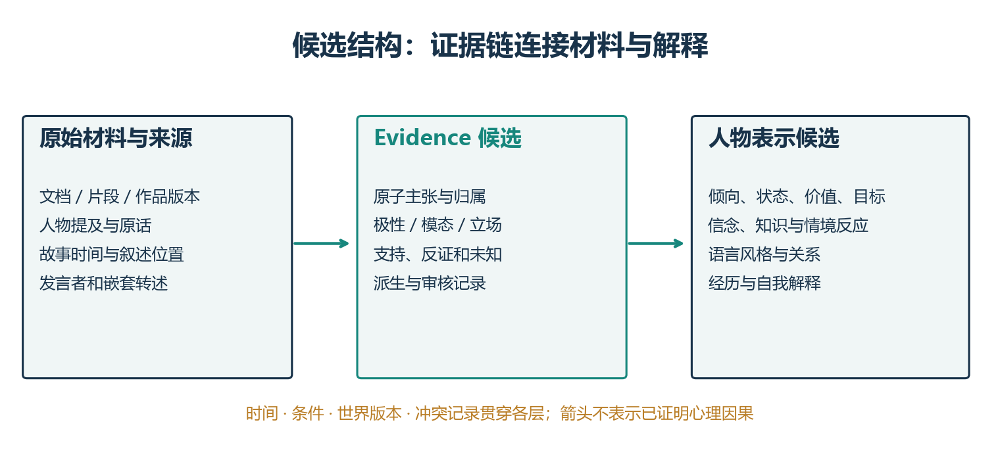
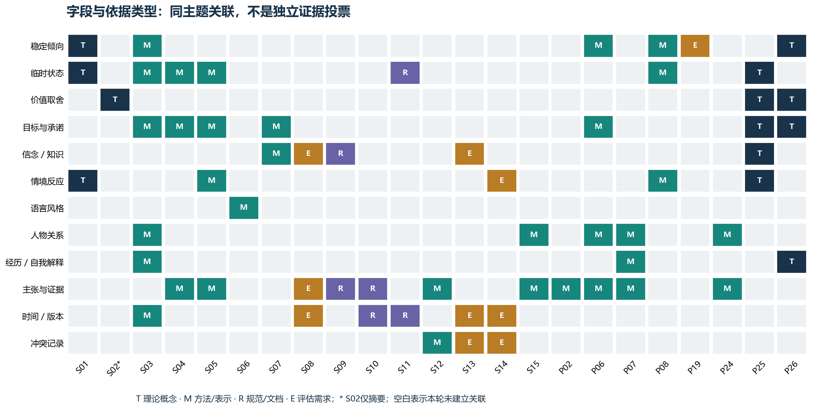

# EchoLoom：建立人设Schema，需要哪些理论和方法依据？

研究驱动产品设计 · Schema专项第一轮 · 截至2026-10-31

## 当前结论

这轮目标是**从不完整、多来源材料重建虚构人物，并保留足以检查与纠正的依据**。我们要为字段和关系找到理由，而不只是积累角色扮演系统的成绩。

目前较合理的设计方向是：用整合人格理论组织不同层次，用情境理论表达行为差异，用人物建模方法连接实际文本，用来源与事实性规范保留“谁根据什么说了什么”。这些是设计依据；最终字段集合仍须经过原创样例检查。

本轮新增核心来源15项：12篇研究论文、3项原始规范/文档；另保留此前8项直接相关研究，共23项。**新增不等于全部逐页精读。** 阅读层级与定位逐条列在附录。Schwartz仅核对摘要；P25已补取可读全文，P26已通过网页工具核读关键理论章节。没有复现代码，也没有第二编码者复核。

旧39篇报告留在归档区。写作界面偏好、陪伴关系体验等暂不进入当前Schema依据；不据此否定它们的其他用途。

## 一、四条研究线分别决定什么

| 研究方向 | 当前必须回答的问题 | 直接产出 |
| --- | --- | --- |
| Personality Psychology | 人物由哪些不同层次组成？稳定与变化怎样兼容？ | 概念词典：traits、states、values、goals、情境反应、经历解释 |
| Persona & Character Simulation | 这些概念怎样变成可供角色使用的表示？ | 分层档案、语言风格、关系与章节边界候选 |
| Information Extraction & Provenance | 谁说的、关于谁、是否被原文支持、来源是否独立？ | Evidence对象、支持边、发言者链、来源与派生关系 |
| Agent Memory & Evaluation | 怎样表达更新、知识边界与无法回答？ | 时间/条件/冲突记录，以及能够暴露字段失败的测试 |

记忆和评价是字段需求的检验工具，不替代人格概念的理论依据。Persona模拟里的“给定档案后生成得好”，也不自动证明从材料抽取档案正确。

## 二、Personality Schema的理论主干

### 1. 人物不应只是一组Big Five数值

McAdams与Pals的整合框架区分较一般的特质、与具体任务和情境相联系的适应，以及个体对自身经历的叙事组织，并把这些放入社会文化背景中。它给我们的启发是**把倾向、目标/策略和经历的意义分层**。人物的履历事实与其自我解释也应分开。[P26 原文Principles 3–4](https://www.e-stimate.dk/wp-content/uploads/2019/09/McAdams-Fundamental-Principles-for-an-Integrative-Science-of-Personality.pdf#page=5)

迁移边界：这是真实人的人格整合理论。虚构人物可能没有完整自我叙事，材料也可能来自外部旁白；不能因此为每个人物补写“人生意义”。生物学基础不是当前文本Schema的必填字段。

### 2. 一致性可以是有条件的行为模式

CAPS把情境理解、信念/预期、情绪、目标/价值以及能力/自我调节等因素放在交互系统中；稳定性可以表现为遇到不同情境时有规律的不同反应。它支持我们保留**人物如何理解情境，以及在什么条件下倾向怎样行动**。[P25 Table 1 / p.253](https://www.david-dai.net/s/Mischel-Shoda-1995.pdf#page=8)

例如，对亲近朋友坦率、对掌权者谨慎，不能仅凭表面差异判为人设崩坏。反过来，一次场景也不足以写出必然的行为规则。工程上应记录候选模式、支持场景、例外和替代解释。

Whole Trait Theory把特质的描述与产生行为的解释机制区分，强调不同情境下状态表现有变化。它帮助我们避免把“稳定倾向”理解为“每时每刻都一样”，同时也不把每次变化都升格为人格变化。[S01 Table 1及CAPS讨论](https://pmc.ncbi.nlm.nih.gov/articles/PMC4472377/)

我们不会从小说中不均匀出现的几次事件估计真实的状态分布或心理因果参数；保留定性倾向和反例即可。

### 3. 价值、目标、意图、情绪应有不同语义

Schwartz的价值理论关注价值优先级及兼容/冲突，并区分价值与特质等概念。本轮只读到出版页摘要，因此只用它支持“价值取舍值得单列”这一概念判断；十类定义与量表映射尚不冻结。[S02 出版页](https://scholarworks.gvsu.edu/orpc/vol2/iss1/11/)

BDI区分代理相信什么、想实现什么，以及已选择并承诺做什么。它是**计算表示依据**，不是人格心理测量理论。我们据此区分belief、goal与intention，不把“想复仇”“决定复仇”和“已经实施复仇”存成同一种事实。[S07 pp.2–3](https://cdn.aaai.org/ICMAS/1995/ICMAS95-042.pdf#page=2)

StoryCommonsense把行动动机与事件后的情绪反应分开，结合自由文本解释与类别标注；这提供可操作的标注思路。其常识短故事中的众包解释不等同于原文明确事实，也不是稳定人格真值。[S04 §2–3](https://aclanthology.org/P18-1213.pdf#page=2)

ATOMIC进一步区分行动者与他人的意图、反应、前提和后果。它适合帮助生成**待验证的解释候选**；“常见情况下如此”不能变成“该人物一定如此”。[S05 Table 1](https://maartensap.com/pdfs/sap2019atomic.pdf#page=3)

## 三、哪些角色研究真正帮助字段设计

### 1. CharacterGPT是直接相关的比较对象

CharacterGPT按章节更新人物信息，采用人格、外表、动机、背景、情绪、关系、变化和冲突八类表示。它与我们的重建目标直接相邻，值得作为字段组织和章节截断的比较对象。[S03 §2](https://aclanthology.org/2025.naacl-industry.24.pdf#page=2)

但其八字段并未被独立正式验证；实验涉及4名角色，作者指出台词不足、语言风格覆盖有限。Table 6的32篇生成故事、7名评价者是下游评价设计，不是八字段完备性的证明。这里的Character Persona Training主要是增量更新档案，不能看名字就当作模型参数微调。[S03 Table 6与Limitations](https://aclanthology.org/2025.naacl-industry.24.pdf#page=7)

因此：借鉴分层和增量思路；不直接复制八字段为最终Schema。

### 2. 语言风格需要独立证据

PERSONAGE把可控制的语言现象映射到生成模块，包括内容选择、句式组织与词汇等。它提示我们把speech_style写成可观察语言现象及样例，而不是只有“冷淡”“温柔”等笼统标签。[S06 Tables 1–2 / §3–4](https://aclanthology.org/P07-1063.pdf#page=2)

其主要实验是英语餐馆推荐领域的外向性表达，不能直接反推中文人物人格。对话对象、场合、反讽、扮装和译者差异都可能影响语言；这些条件是我们的工程扩展，仍需样例验证。

### 3. 关系、知识与经历不应合成一段背景

ARF为文学实体和关系组织本体，适合寻找关系类型候选。但数据包含GPT-4o生成的关系标注；不能当作全量人工真值，更不能用它直接证明“信任程度0.8”这类心理数值。[S15 §3–4](https://aclanthology.org/2025.latechclfl-1.13.pdf#page=3)

FANToM通过信息不对称检查人物知道什么。这说明档案需要区分故事事实与角色可知信息，并保留获得信息的事件或对话范围。可接触信息仍不等于已记住、已理解或相信。[S08 Figure 1](https://aclanthology.org/2023.emnlp-main.890.pdf#page=1)

既有CHIRON、BookWorm、PersoNet与BOOKCOREF分别帮助检查人物档案、事实/解释、情境历史和人物归属；本轮保留它们，其他一般生成成绩不再作为新增检索重点。[P06](https://aclanthology.org/2024.findings-emnlp.499/)、[P07](https://aclanthology.org/2024.findings-emnlp.258/)、[P08](https://arxiv.org/abs/2305.10156)、[P24](https://aclanthology.org/2025.acl-long.1197/)

## 四、Evidence Schema最需要补的理论与规范

### 1. 文档来源、发言者、抽取者是不同对象

FactBank按相关来源记录事件的事实性，并处理嵌套转述。例如，“旁白记载甲说乙背叛了他”，至少应区分说话事件、甲的主张和旁白是否承诺该主张为真。不能把“甲认为乙背叛”直接存为“乙背叛”。[S09 §2.3及§3.3](https://www.cs.brandeis.edu/~roser/pubs/fb_annotGuidelines.pdf#page=3)

PROV-O则帮助区分内容实体、生成过程、责任主体和派生/修订关系。我们借鉴这些关系记录“原文→片段→抽取主张→人格解释→人工修改”，不要求照搬完整OWL。[S10 §3–4](https://www.w3.org/TR/2013/REC-prov-o-20130430/)

两者解决不同问题：FactBank帮助解释**文本中谁承诺什么**；PROV帮助说明**这个数据对象如何产生**。两者都不能自动判断某人格解释正确。

### 2. 主张与证据之间需要有关系，而非仅一个引用框

FActScore提供原子主张核查的思路；CHIRON提示人物描述也需要验证。因此Evidence Schema应能表示某片段支持、反驳、仅部分支持或不足以判断一项主张，并与来源派生关系分开。[P02](https://aclanthology.org/2023.emnlp-main.741/)、[P06](https://aclanthology.org/2024.findings-emnlp.499/)

这是我们的候选标注方案，不是说两篇论文联合给出了上述完整枚举。尤其“事件确实发生”与“事件证明某特质”是两条不同的推理，需要分别审核。

### 3. 来源数量不等于独立证据数量

Dong等研究来源复制对冲突融合的影响，说明多个来源可能重复同一错误。我们据此为derived_from与来源依赖留入口，不按引用条数直接提高置信度。[S12 §1–3](https://www.vldb.org/pvldb/vol2/vldb09-pvldb47.pdf)

该工作旨在找出冲突值中的真实值，并有模型假设。我们的不同改编版本可能分别成立，所以不能直接采用单一真值发现算法，更不能把“官方优先”写死为理论结论。

## 五、时间、版本、条件与矛盾需要分别处理

TimeML/TimeBank给事件、时间表达与时间关系提供明确表示入口。工程上进一步区分故事时间、文本叙述位置、上传/抽取时间和作品版本；其中后两项与虚构世界分区是我们对任务的扩展。[S11](https://timeml.github.io/site/timebank/documentation-1.2.html)

MemConflict区分三种情况：状态随时间变化、错误陈述不应覆盖稳定信息、条件不同的信息各自有效。其合成个人助手任务尚不能证明我们的实现有效，但为避免“全部最新覆盖”提供直接的分类依据。[S14 Figure 1](https://arxiv.org/pdf/2605.20926v1#page=3)

| 材料差异 | 应先检查什么 | 候选处理 |
| --- | --- | --- |
| 早期害怕战斗，后期主动迎战 | 时间/经历是否变化 | 记录变化事件，不抹去早期状态 |
| 对朋友话多，对陌生人沉默 | 条件/关系是否不同 | 形成有条件的行为倾向 |
| 原著没有兄弟，改编有兄弟 | 作品或世界版本是否不同 | 分区并列，由目标版本决定使用 |
| 仇人说他胆小，旁白写他冒险救人 | 发言者、目的和证据关系 | 保留他人评价与行为证据，不简单投票 |
| 新上传的是故事前传 | 上传时间是否被误当故事时间 | 按故事范围检索，不按录入顺序覆盖 |

LongMemEval让信息抽取、更新、时间推理和无法回答可以分别测试。它帮助检验时间与未知字段是否可用，而非提供人格本体。[S13 §3](https://arxiv.org/pdf/2410.10813v2#page=4)

## 六、现在可以形成的结构候选

这里的“Personality Schema”是项目中的人物表示接口，包含部分人格、知识和行为模块；不声称这些模块全都是心理学意义上的人格。各模块的来源及进入条件见字段依据表。

Personality侧先保留稳定倾向、状态、价值/目标、信念/知识、情境反应、语言风格、关系和背景/自我解释。Evidence侧先保留来源、片段、原子主张、发言者链、极性/模态、支持/反证边和生成/审核记录。时间、条件、版本与冲突连接两侧。

**暂不冻结的内容**：Big Five数值、十类价值枚举、信任/亲密评分、单一置信分数、跨世界自动真值融合，以及人格自动因果解释。理由分别是材料与测量不匹配、全文或验证不足、概念边界不清。

## 七、下一步应交付什么

先完成一个能处理反例的概念词典：每个字段的定义、观察单位、正反例、未知情况、证据要求。接着用原创小样例手工编码，检查同一行为是否有不同解释、同一主张是否属于不同人物/时间/版本。

然后裁剪字段并正式化Schema v0.1。只有能说明“为什么需要、何时填写、凭什么判断、何时留空、怎样验证”的字段才进入核心；其余作为可选或待研究项。完整顺序见下一步计划。

## 阅读与检索限制

本轮是围绕字段决策的目的性检索，不是系统综述，也没有全领域统计分母。下载与阅读状态分开；有些网页可读但本地抓取失败。S01、P26、S09通过网页核对指定正文；S02只有摘要。其余新核心研究和P25使用已取得可读文本核对与Schema相关章节，不声称逐页精读完成。

定性来源矩阵描述“哪类依据支持哪项设计”，不计算文献投票数、证据总分或跨任务准确率。不同理论互有分歧；兼容地借用概念不等于它们已被统一验证。更多人类研究尤其跨文化、中文语言风格和关系态度仍需补核。

<!-- GENERATED_APPENDIX_START -->
## 附录：候选字段的逐项依据

| 模块/候选对象 | 主要依据及性质 | 最小表示建议（我们的推导） | 必须保留的边界/反例 | 进入正式Schema的检查 |
| --- | --- | --- | --- | --- |
| `traits` 稳定倾向 | P26/S01理论；P06方法；P19评估 | 描述、适用情境、支持与反例；Big Five仅可选映射 | 一次沉默不能推出内向；不能把量表回答当人物真值 | 跨情境行为和替代解释能并列表示 |
| `states` 临时状态 | P25/S01理论；S04方法 | 体验者、状态、触发事件、故事时间、结束/未知 | 焦虑一晚不等于稳定神经质；情绪不等于生理状态 | 同角色不同时间状态不互相覆盖 |
| `values` 价值取舍 | P25/P26理论；S02摘要 | 重视什么、取舍情景、优先级证据；暂不固定量表数值 | 说重视诚实与实际撒谎可以并存，须分别记录 | 自述、行为、解释可以区分；补S02全文 |
| `goals` / `intentions` 目标与承诺 | P25理论；S07计算架构；S04方法 | 持有者、目标、动机、已承诺计划、条件和时效 | 想做不等于计划做，计划做不等于已做 | 愿望相冲突、计划放弃和目标变化可表达 |
| `beliefs_knowledge` / 记忆入口 | S07架构；S08评估；S09规范；S13评估 | 命题、持有者、获得时间、获知依据；经历连到事件 | 作者/读者知道不等于角色知道；错误信念仍可保留 | 同一命题可有不同人物立场；未来剧情不泄漏 |
| `behavior_patterns` 情境反应 | P25/S01理论；P08方法；S14评估 | 情境→解释/情绪/目标→行为倾向，含例外和未知 | 面对朋友健谈、面对上司沉默不必是矛盾 | 不同情境可并存；因果链无证据时保持假设 |
| `speech_style` 语言风格 | S06方法；S03揭示覆盖不足 | 用词、句式、礼貌、话轮等现象＋对象/场合＋原话 | 角色扮装、反讽、翻译或不同作者可改变语言 | 至少能存多个对话对象条件；无台词可留未知 |
| `relationships` 人物关系 | S03方法；S15本体；P24归属 | 两端人物、关系类型、主张来源、故事时间；态度分开 | “是兄弟”不等于“彼此信任”；方向/态度细分待验证 | 结构关系与主观评价不混同，别名可消歧 |
| `biography` / `identity_narrative` 背景与自我解释 | P26理论；S03方法 | 经历为事件；人物如何解释经历为另一层 | 坏经历不自动证明某特质；他人传记不等于自我认同 | 事件、角色自述、外部分析能分别存储 |
| `evidence` 主张及支持边 | P02/P06方法；S09/S10规范；S12融合 | 原子主张、文档/片段定位、发言者链、极性/模态、支持/反证边、生成/审核记录 | 有引用不等于支持；重复转述不等于独立证据 | 来源可信、原文承诺、抽取正确、支持程度分别处理 |
| `time_version` 时间与版本 | S11规范；S03方法；S13评估；S10来源 | 故事时间、叙述位置、录入时间、目标章节、作品/世界版本 | 后上传的早期章节不应覆盖后期状态 | 相对时间与未知合法；跨版本不同事实可并存 |
| `conflicts` 冲突记录 | S14评估；S12融合；版本扩展是工程假设 | 冲突双方、时间/事实/条件/版本分类、是否解决及理由 | “最新优先”“官方永远优先”都不能自动成立 | 不同条件/版本先分区，再检查同范围矛盾 |

## 附录：来源与阅读层级

| ID | 年份与来源 | 类型 | 阅读层级 |
| --- | --- | --- | --- |
| [S01](../../organization/reading-notes/S01-schema-basis.md) | 2015 · [Whole Trait Theory](https://pmc.ncbi.nlm.nih.gov/articles/PMC4472377/) | 理论整合 | 网页全文指定章节核读 |
| [S02](../../organization/reading-notes/S02-schema-basis.md) | 2012 · [An Overview of the Schwartz Theory of Basic Values](https://scholarworks.gvsu.edu/orpc/vol2/iss1/11/) | 理论综述 | 摘要核对 |
| [S03](../../organization/reading-notes/S03-schema-basis.md) | 2025 · [CharacterGPT: A Persona Reconstruction Framework for Role-Playing Agents](https://aclanthology.org/2025.naacl-industry.24/) | 人物重建方法 | 全文定向核读 |
| [S04](../../organization/reading-notes/S04-schema-basis.md) | 2018 · [Modeling Naive Psychology of Characters in Simple Commonsense Stories](https://aclanthology.org/P18-1213/) | 人物心理标注框架 | 全文定向核读 |
| [S05](../../organization/reading-notes/S05-schema-basis.md) | 2019 · [ATOMIC: An Atlas of Machine Commonsense for If-Then Reasoning](https://arxiv.org/abs/1811.00146) | 常识知识表示 | 全文定向核读 |
| [S06](../../organization/reading-notes/S06-schema-basis.md) | 2007 · [PERSONAGE: Personality Generation for Dialogue](https://aclanthology.org/P07-1063/) | 语言生成方法 | 全文定向核读 |
| [S07](../../organization/reading-notes/S07-schema-basis.md) | 1995 · [BDI Agents: From Theory to Practice](https://cdn.aaai.org/ICMAS/1995/ICMAS95-042.pdf) | 计算代理架构 | 全文定向核读 |
| [S08](../../organization/reading-notes/S08-schema-basis.md) | 2023 · [FANToM: A Benchmark for Stress-testing Machine Theory of Mind in Interactions](https://aclanthology.org/2023.emnlp-main.890/) | 知识可达性评估 | 全文定向核读 |
| [S09](../../organization/reading-notes/S09-schema-basis.md) | 2008 · [FactBank 1.0 Annotation Guidelines / Corpus Documentation](https://www.cs.brandeis.edu/~roser/pubs/fb_annotGuidelines.pdf) | 原始标注规范 | 网页全文指定章节核读 |
| [S10](../../organization/reading-notes/S10-schema-basis.md) | 2013 · [PROV-O: The PROV Ontology](https://www.w3.org/TR/2013/REC-prov-o-20130430/) | W3C规范 | 全文定向核读 |
| [S11](../../organization/reading-notes/S11-schema-basis.md) | 2006 · [TimeBank 1.2 Documentation / TimeML](https://timeml.github.io/site/timebank/documentation-1.2.html) | 原始标注规范 | 全文定向核读 |
| [S12](../../organization/reading-notes/S12-schema-basis.md) | 2009 · [Integrating Conflicting Data: The Role of Source Dependence](https://www.vldb.org/pvldb/vol2/vldb09-pvldb47.pdf) | 多来源融合方法 | 全文定向核读 |
| [S13](../../organization/reading-notes/S13-schema-basis.md) | 2025 · [LongMemEval: Benchmarking Chat Assistants on Long-Term Interactive Memory](https://arxiv.org/abs/2410.10813v2) | 长时记忆评估 | 全文定向核读 |
| [S14](../../organization/reading-notes/S14-schema-basis.md) | 2026 · [MemConflict: Evaluating Long-Term Memory Systems Under Memory Conflicts](https://arxiv.org/abs/2605.20926v1) | 冲突记忆评估（预印本） | 全文定向核读 |
| [S15](../../organization/reading-notes/S15-schema-basis.md) | 2025 · [Artificial Relationships in Fiction: A Dataset for Advancing NLP in Literary Domains](https://aclanthology.org/2025.latechclfl-1.13/) | 文学关系本体与数据 | 全文定向核读 |
| [P02](../../organization/reading-notes/P02-schema-basis.md) | 2023 · [FActScore: Fine-grained Atomic Evaluation of Factual Precision in Long Form Text Generation](https://aclanthology.org/2023.emnlp-main.741/) | 已有核心研究 | 沿用上一轮定向核读 |
| [P06](../../organization/reading-notes/P06-schema-basis.md) | 2024 · [CHIRON: Rich Character Representations in Long-Form Narratives](https://aclanthology.org/2024.findings-emnlp.499/) | 已有核心研究 | 沿用上一轮定向核读 |
| [P07](../../organization/reading-notes/P07-schema-basis.md) | 2024 · [BookWorm: A Dataset for Character Description and Analysis](https://aclanthology.org/2024.findings-emnlp.258/) | 已有核心研究 | 沿用上一轮定向核读 |
| [P08](../../organization/reading-notes/P08-schema-basis.md) | 2023 · [Personality Understanding of Fictional Characters during Book Reading](https://arxiv.org/abs/2305.10156) | 已有核心研究 | 沿用上一轮定向核读 |
| [P19](../../organization/reading-notes/P19-schema-basis.md) | 2024 · [InCharacter: Evaluating Personality Fidelity in Role-Playing Agents through Psychological Interviews](https://aclanthology.org/2024.acl-long.102/) | 已有核心研究 | 沿用上一轮定向核读 |
| [P24](../../organization/reading-notes/P24-schema-basis.md) | 2025 · [BOOKCOREF: Coreference Resolution at Book Scale](https://aclanthology.org/2025.acl-long.1197/) | 已有核心研究 | 沿用上一轮定向核读 |
| [P25](../../organization/reading-notes/P25-schema-basis.md) | 1995 · [A Cognitive-Affective System Theory of Personality: Reconceptualizing Situations, Dispositions, Dynamics, and Invariance in Personality Structure](https://www.david-dai.net/s/Mischel-Shoda-1995.pdf) | 已有核心研究 | 本轮补取全文并核读关键章节 |
| [P26](../../organization/reading-notes/P26-schema-basis.md) | 2006 · [A New Big Five: Fundamental Principles for an Integrative Science of Personality](https://www.e-stimate.dk/wp-content/uploads/2019/09/McAdams-Fundamental-Principles-for-an-Integrative-Science-of-Personality.pdf) | 已有核心研究 | 本轮通过网页全文核读Principles 3–4 |

完整数据见[23项来源](../../data/schema-sources.json)、[检索记录](../../data/search-log.json)与[下一步计划](../../plans/next-steps.md)。
<!-- GENERATED_APPENDIX_END -->
